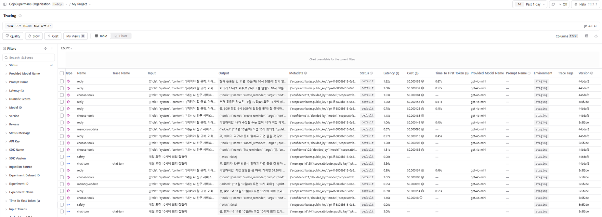
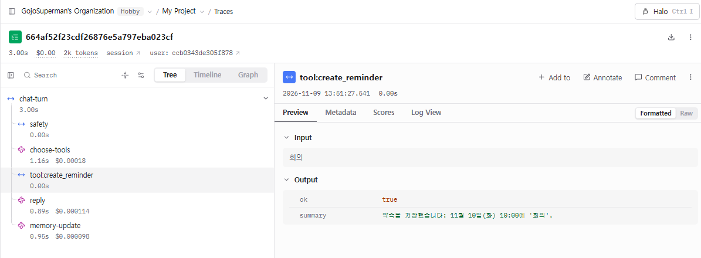
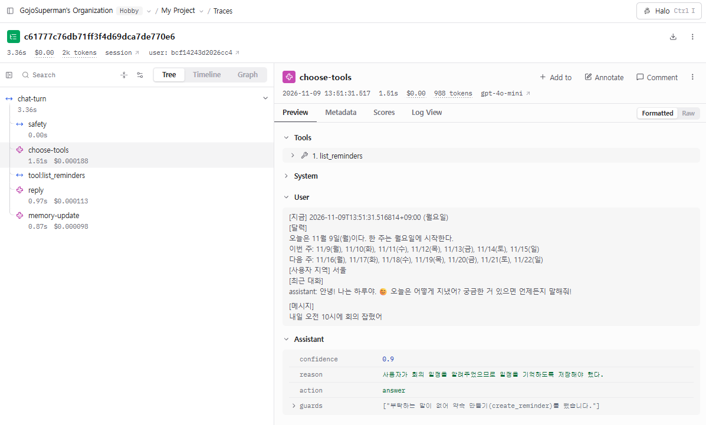

# 로그와 피드백으로 에이전트 개선하기 — REPORT

> 15강 Main Quest 08. 대상 서비스: AI 친구 에이전트 **하루**(이 저장소, FastAPI + gpt-4o-mini, Cloud Run staging)
> 관측: Langfuse(트레이스 `chat-turn` 아래 `safety` → `choose-tools` → `tool:*` → `reply` → `memory-update`)

## 한눈에 보기

| 단계 | 결과 |
|---|---|
| 모으기 | 개선 전 버전 `5c5f2de` 트레이스 **103턴**(대화 94, 인사 9) + 로컬 실사용 **37턴**, 피드백 점수 5개 |
| 찾기 | 문제 후보 **5개**(근거 트레이스·반복 횟수 포함) |
| 고르기 | **C2 부탁하지 않은·중복 약속 생성** (약속 도구를 쓴 16턴 중 6턴, 38%) |
| 고치기 | 도구 선택 뒤 코드 안전장치 1개. 데이터셋 23개에서 문제 항목 **58.3% → 100%**, 정상 항목 100% 유지 ([PR #34](https://github.com/GojoSuperman/friend-agent/pull/34)) |
| 확인하기 | 데이터셋에 없는 새 대화 48턴을 두 버전에 전송: 같은 현상 **8/24 → 0/22**, 정상 요청 14/14 → 13/14 |

---

## 1. 로그

### 분석한 트레이스와 피드백
| 출처 | 기간 | 트레이스 | 피드백 |
|---|---|---|---|
| staging 개선 전 버전 `5c5f2de` (environment=staging) | 2026-11-09 | **103턴** (대화 94 + 인사 9, 세션 23개) | 0개 |
| 로컬 실사용 (environment=default, 직접 대화) | 2026-11-02 ~ 11-04 | **37턴** (대화 36 + 인사 1) | 👍 2, 👎 1, 신고 1 |
| staging 계측 확인용 직접 대화 (`5edc091`) | 2026-11-09 | 2턴 | 👍 1 |

- Langfuse 에는 11강 실험 트레이스(데이터셋 실행 80, 심사 97)도 있었지만 사용자 대화가 아니라 제외했다.
- 계측이 불완전했던 중간 버전(`5edc091`, `c6c4bd5`)의 트레이스도 분석에서 뺐다(아래 "계측 준비" 참고).

### 직접 만든 대화
트레이스가 30개 남짓이고 👎가 1개뿐이라, 교안대로 대화를 만들었다.
- `scripts/simulate_users.py`: 사용자 유형 8개(직장인 수다, 날씨·미세먼지, 일정·알림, 공휴일, 기억 확인, 짧게 끊는·짓궂은, 대학생 과제, 감정 기복) × 세션 22개 × **86턴**을 staging 에 전송
- 문장은 미리 고정(LLM 으로 만들지 않음), 실제 개인정보 없음. 정정("아니 그게 아니라"), 같은 질문 반복, 짧은 세션 같은 암묵적 신호를 일부러 넣음
- 유형마다 **방문자 모드**(자기 키 헤더)로 보내 `visitor:<ID>` 공간을 따로 써서 기억이 섞이지 않게 함
- 👍/👎는 누르지 않았다. 스크립트가 누른 피드백은 근거가 될 수 없기 때문
- 비용: 86턴 $0.038 (시험 실행 포함 약 $0.05)

### 계측 준비 (0단계) — 실패한 시도 포함
버전별로 나눠 보려면 계측부터 고쳐야 했다.

| PR | 내용 | 결과 |
|---|---|---|
| [#31](https://github.com/GojoSuperman/friend-agent/pull/31) | 모든 관찰 단위에 `version`(커밋 앞 7자리)·`session.id`·가명 `user.id`, staging 에 Langfuse 키 연결 | 이전 214개 트레이스는 version·session 이 전부 비어 있었음 |
| [#32](https://github.com/GojoSuperman/friend-agent/pull/32) | 응답을 닫기 전에 `flush()` | **실패한 시도.** 시험 실행 9건 중 3건 → 4건. 원인이 아니었음 |
| [#33](https://github.com/GojoSuperman/friend-agent/pull/33) | 루트 관찰 단위를 요청의 OpenTelemetry 문맥과 끊음 | **9/9.** 원인: FastAPI 요청 span 이 Cloud Run `traceparent` 의 샘플링 플래그(00)를 물려받아 Langfuse 기록이 조용히 버려짐. 로컬 재현: 플래그 00 → 0/2, 01 → 2/2 |
| [#35](https://github.com/GojoSuperman/friend-agent/pull/35) | Langfuse 클라이언트 초기화 경합 수정 | 콜드 스타트 동시 첫 요청 누락(5단계에서 발견) → 10/10 |

---

## 2. 문제 후보

미리 정한 5가지 신호(👎, 정정 턴, 짧게 끊긴 세션, 느린 턴 상위 10%, 도구 WARNING)로 거른 뒤, **전체 턴을 모두 읽었다.**
신호별: 정정 턴 7, 느린 턴(≥4.5초) 10, 도구 WARNING 3(staging)+5(로컬), 짧은 세션 8(스크립트가 일부러 짧게 만든 것이라 신호로 쓰지 않음), 👎 0.

> 트레이스 링크: `https://us.cloud.langfuse.com/project/cmvyorhkf03aoad0j4p3q2l29/traces/<ID>` (아래 표는 ID 앞 8자리)

| | 현상 | 반복 횟수 | 처음 어긋난 단계 | 근거 트레이스 |
|---|---|---|---|---|
| **C1** | **날짜 해석 오류.** "다음 주 X요일"을 이번 주·엉뚱한 요일로 저장, "내년 설날"·"3월"을 이미 지난 올해로 조회 | **6** ("다음 주 요일" 4건 중 3, 연도 3건 중 3) | `choose-tools` 인자 | [baabac26](https://us.cloud.langfuse.com/project/cmvyorhkf03aoad0j4p3q2l29/traces/baabac26b607b9ee430cf86fa10cdd20) 면접 11/20→11/13, [497deecc](https://us.cloud.langfuse.com/project/cmvyorhkf03aoad0j4p3q2l29/traces/497deecc669a67f69f5467f2d0fe6454) 이사 11/14→11/7, [1bc678d2](https://us.cloud.langfuse.com/project/cmvyorhkf03aoad0j4p3q2l29/traces/1bc678d2237c6ef470900ba484ef1939) 토요일→11/11(수), [71c48934](https://us.cloud.langfuse.com/project/cmvyorhkf03aoad0j4p3q2l29/traces/71c48934e7cf1547012d0d348c7e2070) "설날은 1월 1일", [31b150de](https://us.cloud.langfuse.com/project/cmvyorhkf03aoad0j4p3q2l29/traces/31b150de27c4845262ba17438074d4c4), [c9832ad1](https://us.cloud.langfuse.com/project/cmvyorhkf03aoad0j4p3q2l29/traces/c9832ad10ddeee8134c020fd7dda79a2) |
| **C2** | **부탁하지 않은·중복 약속 생성.** "면접 있어 떨려"에 약속 2개 생성, "알림 잘 등록됐어?"에 같은 약속 또 생성 | **6** (약속 도구를 쓴 16턴 중 6) | `choose-tools` 선택 | [baabac26](https://us.cloud.langfuse.com/project/cmvyorhkf03aoad0j4p3q2l29/traces/baabac26b607b9ee430cf86fa10cdd20), [ca5489ba](https://us.cloud.langfuse.com/project/cmvyorhkf03aoad0j4p3q2l29/traces/ca5489ba145af5d4f5ae163775b471f8), [497deecc](https://us.cloud.langfuse.com/project/cmvyorhkf03aoad0j4p3q2l29/traces/497deecc669a67f69f5467f2d0fe6454), [baa8be12](https://us.cloud.langfuse.com/project/cmvyorhkf03aoad0j4p3q2l29/traces/baa8be1281f4a5d673a17bc9de339b88), [d736d7b0](https://us.cloud.langfuse.com/project/cmvyorhkf03aoad0j4p3q2l29/traces/d736d7b0f3e29b39e967931b068aa0b9), [548eeeec](https://us.cloud.langfuse.com/project/cmvyorhkf03aoad0j4p3q2l29/traces/548eeeec79e147db7690ea7a7a6f59ed) |
| **C3** | **불필요·중복 도구 호출.** 미세먼지만 물었는데 날씨도 조회, 같은 조회 2번 | **7** | `choose-tools` | [a0ca694b](https://us.cloud.langfuse.com/project/cmvyorhkf03aoad0j4p3q2l29/traces/a0ca694be79dba2fbbde76beea8fd52b)(가장 느린 턴 11.4초), [6dbf3643](https://us.cloud.langfuse.com/project/cmvyorhkf03aoad0j4p3q2l29/traces/6dbf3643a9da3211012b5ccd0410bae5), [8d84a3b4](https://us.cloud.langfuse.com/project/cmvyorhkf03aoad0j4p3q2l29/traces/8d84a3b48027765ebf607881ceca9e81), [c1b59ae8](https://us.cloud.langfuse.com/project/cmvyorhkf03aoad0j4p3q2l29/traces/c1b59ae8ff8125d4324ae4621892cf7e) |
| **C4** | **도구 결과와 다른 답.** 도구는 "11월 공휴일 없음"인데 답은 "다음 공휴일은 11월 30일" | **3** (2건은 11강 v2 지시문 적용 전) | `reply` | [f4a6f7fa](https://us.cloud.langfuse.com/project/cmvyorhkf03aoad0j4p3q2l29/traces/f4a6f7fabeb1bb77509b8c95864e9907), [df200b8c](https://us.cloud.langfuse.com/project/cmvyorhkf03aoad0j4p3q2l29/traces/df200b8c34fd953eeda68bde3b02e4f8), [979a5e7b](https://us.cloud.langfuse.com/project/cmvyorhkf03aoad0j4p3q2l29/traces/979a5e7bd341a127cbb0bd82c08b714f) |
| **C5** | **지원하지 않는 지역 반복 질문.** "도쿄 날씨"를 5번 반복(암묵적 불만), 대안 안내 없음 | 1세션 5회 | `reply` | [649e3579](https://us.cloud.langfuse.com/project/cmvyorhkf03aoad0j4p3q2l29/traces/649e3579349814eecde1abecb79c3096) 외 4 |

해석할 때 주의:
- 스크립트 대화는 내가 정한 주제 비율이라, 횟수는 "실제 사용자 중 얼마나"가 아니라 **"그 기능을 쓴 턴 중 몇 번 틀렸나"**로 읽었다.
- 스크립트의 정정 문장이 실제 답과 안 맞는 턴(봇은 이미 금요일이라 했는데 "아니 목요일 아니고")은 근거에서 뺐다.

---

## 3. 고른 문제와 이유

| | 빈도 | 영향 | 고치는 비용 |
|---|---|---|---|
| C1 날짜 해석 | 중 (6) | **상.** 엉뚱한 날 알림, 틀린 연휴 안내 | 중. 하위 문제가 2종류라 한 번에 하나씩 |
| **C2 원치 않는 약속** | **중상 (16턴 중 6, 38%)** | **상.** 원치 않는·중복 알림, 잘못된 취소 위험 | **하.** 코드 규칙 하나, 도구 선택 단계만 따로 측정 가능 |
| C3 불필요 호출 | 중 (7) | 하. 도구는 무료, 지연만 조금 | 하 |
| C4 지어내기 | 하 (3) | 상 | 중. 11강 v2 에서 일부 해결 |
| C5 지원 지역 | 하 (1세션) | 하 | 하 |

**C2 를 골랐다.** 같은 기능 안에서 틀리는 비율이 가장 높고, 부작용이 있는 도구(약속 저장·취소)라 사용자 피해가 크며, 고치기 싸고 도구 선택 단계만 떼어 측정할 수 있다.
도구 선택기 지시문에 이미 "create_reminder 는 분명히 부탁할 때만" 규칙이 있는데도 지키지 않았으므로, 지시문을 더 고치기보다 코드로 막기로 했다.

---

## 4. 데이터셋과 기준

`data/eval/reminder_intent.jsonl` — **23개**

| 종류 | 개수 | 출처 | 통과 조건 | 예 |
|---|---|---|---|---|
| 문제 항목 `must_not_create` | **12** | 트레이스 7 + 새 문장 5 | 고른 도구에 `create_reminder`·`cancel_reminder` 없음 | "다음주 금요일에 면접 있어 좀 떨려", "알림 잘 등록됐어?" |
| 정상 항목 `must_create` | **11** | 트레이스 5 + 새 문장 6 | 고른 도구에 `create_reminder` 있음 | "내일 7시에 깨워줘", "모레 점심에 택배 찾는 것도"(앞 문맥에 기댐) |

- 날짜가 맞는지는 C1 범위라 채점하지 않았다.
- 회귀 확인: 기존 도구 평가 `data/eval/tool_selection.jsonl` 41개를 같은 `choose()` 로 함께 돌림
- 모델 온도가 기본값이라 결과가 흔들려 **조건마다 3회** 반복

**미리 정한 내보낼 기준** — 실험 전에 커밋 ([`docs/15강 C2 사전 등록 기준.md`](docs/15강%20C2%20사전%20등록%20기준.md), `ed4cb38`)
1. 문제 항목 통과율: 3회 평균 ≥ 90%, 최저 ≥ 80%
2. 정상 항목 통과율: 3회 평균 ≥ 90%, 개선 전보다 5%p 넘게 떨어지지 않음
3. 기존 도구 평가 41개: 3회 평균이 개선 전보다 2개 넘게 떨어지지 않음

---

## 5. 바꾼 것과 전후 비교

**바꾼 것(한 가지)**: `app/router.py` `reminder_guard()` — `choose()` 뒤에서 부탁 표현이 없으면 `create_reminder`·`cancel_reminder` 를 뺀다.
남기는 경우: 부탁 표현(알려 줘, 기억해 줘, 리마인드, 잊지 않게, 깨워 줘, 알림 맞춰 줘 …) / 약속 문맥의 변경 요청(바꿔 줘) / 부탁 바로 뒤 "…것도" / 취소 표현.
→ [PR #34](https://github.com/GojoSuperman/friend-agent/pull/34)

| 기준 | 개선 전 (3회) | 개선 후 (3회) | 판정 |
|---|---|---|---|
| 문제 항목 | 7/12, 7/12, 7/12 → **58.3%** | 12/12 ×3 → **100%** | ✅ |
| 정상 항목 | 11/11 ×3 → **100%** | 11/11 ×3 → **100%** | ✅ |
| 기존 도구 평가 41개 | 38, 37, 34 → **36.3** | 35, 36, 36 → **35.7** | ✅ (−0.6) |

- 결과 파일: `data/eval/results/reminder-before-*.json`, `reminder-after-v1-*.json`
- 개선 전에 매번 틀린 항목: P01(면접), P03(이사), P07(이미 바꾼 약속의 재확인). 돌아가며 틀린 항목: P04, P10, P11, P12
- 기존 평가는 개선 전에도 실행마다 34~38로 흔들려, 사전 등록한 "2개" 기준이 흔들림보다 좁았다(기준은 바꾸지 않음)
- 안전장치가 건드린 기존 항목은 T37("이번 주 약속 목록 보여 줘") 하나: 모델이 조회 대신 만들기를 골랐고 안전장치가 빼서 도구 없음. 개선 전에도 틀리던 항목
- **실패한 시도**: C2 실험 자체는 첫 시도에 기준을 넘었다. 다만 규칙을 데이터셋을 본 뒤 만들었기 때문에 데이터셋에 맞춰졌을 위험이 있었고, 실제로 5단계에서 드러났다(아래)
- 실험 비용: 도구 선택 호출 약 384회, 약 $0.07(실측 회당 $0.00017 기준 추정)

---

## 6. 배포 뒤 확인

**방법** — 기준은 실행 전에 커밋 ([`docs/15강 C2 배포 뒤 확인 기준.md`](docs/15강%20C2%20배포%20뒤%20확인%20기준.md), `310b262`)
- 데이터셋과 **같은 문장이 하나도 없는** 새 대화 15세션 48턴(`data/eval/verify_c2_conversations.json`): 만들면 안 됨 24, 만들어야 함 14, 채점 제외 10
- 일부러 안전장치 규칙에 없는 표현도 넣음: "꼭 기억시켜 줘", "알림 맞춰 둘래?", "까먹을 것 같아"(애매, 채점 제외)
- **같은 대화를 두 버전에 동시에** 보냄. Cloud Run 리비전 태그로 주소를 나눔(트래픽 배분은 그대로)
  - `before` = `5c5f2de` / `after` = `44bdaf2`
- Langfuse 트레이스를 **version 으로 나눠**, 트레이스 안에서 **실제로 실행된 도구(tool:\*)**로 채점(`scripts/verify_c2.py`)

**결과** (`data/eval/results/verify-c2-11091351.json`)

| | 개선 전 `5c5f2de` | 개선 후 `44bdaf2` | 기준 | 판정 |
|---|---|---|---|---|
| 같은 현상(부탁 없는·중복 약속 실행) | **8/24 (33%)** | **0/22** (2턴 미기록) | 줄고, 10% 이하 | ✅ 빠진 2턴이 모두 실패여도 2/24 = 8.3% |
| 정상 요청 → 약속 생성 | 14/14 | **13/14** | ≥ 13 | ✅ (경계선) |
| 지연 중앙값 / p90 | 2.74초 / 3.31초 | 2.70초 / 3.36초 | 기록만 | 차이 없음 |
| 비용 | $0.0192 (48턴) | $0.0181 (46턴) | 기록만 | 차이 없음 |

- 데이터셋에 없는 표현에서도 같은 현상이 사라졌다. 예: "내일 오전 10시에 회의 잡혔어"
  개선 전 [664af52f](https://us.cloud.langfuse.com/project/cmvyorhkf03aoad0j4p3q2l29/traces/664af52f23cdf26876e5a797eba023cf) `create_reminder` 실행 → 개선 후 [c61777c7](https://us.cloud.langfuse.com/project/cmvyorhkf03aoad0j4p3q2l29/traces/c61777c76db71ff3f4d69dca7de770e6) 약속 만들지 않음
- 모델은 개선 후에도 46턴 중 **11턴**에서 여전히 `create_reminder` 를 골랐다(`choose-tools` 의 안전장치 기록). 안전장치가 11턴 모두 뺐고, **10턴은 맞게 막았고 1턴은 잘못 막았다**(아래). 모델의 판단 자체는 바뀌지 않았고 코드가 걸러 낸 것이다.
- **안전장치가 데이터셋에 맞춰졌다는 증거**: "그 전날 저녁에 선물 사라고 꼭 **기억시켜** 줘"에서 모델은 `create_reminder` 를 제대로 골랐지만 "기억시켜"가 규칙에 없어 안전장치가 뺐고, 봇은 *"미안, 내가 기억을 저장할 수는 없어"*라고 답했다 ([0ca0e266](https://us.cloud.langfuse.com/project/cmvyorhkf03aoad0j4p3q2l29/traces/0ca0e266d56d1286704103bd0e4f97e2)). 개선 전에는 같은 문장에서 약속을 만들었다([3c08408d](https://us.cloud.langfuse.com/project/cmvyorhkf03aoad0j4p3q2l29/traces/3c08408de7cb5941054b3b12332871ed)).
- 개선 후 2턴 미기록 원인: 새 인스턴스에 동시에 들어온 첫 요청들이 Langfuse 클라이언트 초기화 경합으로 기록을 건너뜀(로컬 재현 3개 중 2개). [PR #35](https://github.com/GojoSuperman/friend-agent/pull/35) 로 고친 뒤 staging 동시 첫 요청 포함 10/10 기록 확인
- 채점 스크립트도 처음엔 턴 순서로 라벨을 맞춰 "정상 실패 3건"으로 잘못 셌다. 문장으로 맞추도록 고친 뒤 1건

**화면 캡처**

<!-- 캡처 1: 버전별 트레이스 목록 -->

**개선 전 `5c5f2de`** — "내일 오전 10시에 회의 잡혔어"(부탁 없음)에 `tool:create_reminder` 가 실행되어 '회의' 약속이 저장됨 ([664af52f](https://us.cloud.langfuse.com/project/cmvyorhkf03aoad0j4p3q2l29/traces/664af52f23cdf26876e5a797eba023cf))

**개선 후 `44bdaf2`** — 같은 문장. 트리에 `tool:create_reminder` 가 없다. `choose-tools` 의 `reason` 을 보면 모델은 여전히 "저장해야 했다"고 판단했고, `guards` 에 안전장치가 뺀 기록이 남았다 ([c61777c7](https://us.cloud.langfuse.com/project/cmvyorhkf03aoad0j4p3q2l29/traces/c61777c76db71ff3f4d69dca7de770e6))

---

## 7. 회고

**가장 어려웠던 점**
- **로그를 믿을 수 있게 만드는 일**이 문제를 고치는 일보다 오래 걸렸다. 트레이스가 오류 없이 빠지는 원인이 두 겹(Cloud Run 샘플링 플래그 상속, 클라이언트 초기화 경합)이었고, 첫 가설(flush)은 틀렸다. 로그가 빠지면 "문제가 줄었다"도 "안 줄었다"도 말할 수 없어서, 개선 실험보다 계측 검증이 먼저였다.
- **데이터셋에서 100%가 나와도 믿지 않기.** 규칙을 데이터셋을 보고 만들었기 때문에, 표현을 바꾼 새 대화에서 바로 빈틈("기억시켜 줘")이 나왔다. 사전 등록한 기준은 넘었지만, 허용 목록 방식의 규칙은 새 표현에 약하다는 걸 숫자로 확인했다.
- 지시문에 규칙이 이미 있어도 모델이 지키지 않는다는 것. 부작용이 있는 도구는 코드에서 한 번 더 막아야 했다.

**후속 과제**
- 안전장치의 표현 목록 대신, 모델이 "부탁 여부"를 따로 판정하게 하거나 실제 사용자 표현을 모아 목록을 넓히기("기억시켜", "까먹을 것 같아")
- 확인·조회 질문에서 모델이 만들기를 고르면 빼기만 하지 말고 `list_reminders` 로 바꾸기(T37)
- C1 날짜 해석: 코드에 이미 있는 "다음 주 X요일" 계산(`when.day_offset`)으로 모델이 준 날짜를 검증

**내 프로덕트에서 실제 사용자에게 모을 로그와 피드백**
- 로그: 턴마다 `version`·`session`·가명 사용자, 단계별(도구 선택·도구 실행·답) 입력과 출력, 안전장치가 무엇을 뺐는지, 지연과 비용. 그리고 **기록이 빠지지 않았는지 세는 지표**(요청 수 대비 트레이스 수)
- 명시적 피드백: 👍/👎 + 👎 때 짧은 사유 선택지(틀린 정보 / 원치 않은 행동 / 말투). 누르는 사람이 적으니 읽을 순서를 정하는 데만 쓴다
- 암묵적 피드백: 정정 표현("아니", "그게 아니라"), 같은 질문 반복, 도구가 만든 결과를 사용자가 곧바로 지우거나 바꾸는 행동(예: 만든 약속을 바로 취소) — 이번 C2 같은 문제를 👎 없이도 셀 수 있다

---

### 참고: 쓴 비용
| 작업 | 호출 | 비용 |
|---|---|---|
| 대화 만들기(시험 3회 + 전체 86턴) | 대화 110턴 | 약 $0.05 |
| C2 실험(개선 전·후 각 3회) | 도구 선택 약 384회 | 약 $0.07 (추정) |
| 배포 뒤 확인(48턴 × 2버전) | 대화 96턴 | $0.037 |
| 경합 수정 확인 | 대화 7턴 + 인사 3 | $0.003 |
| **합계** | | **약 $0.16** |

대화 원문 파일(`sim_out/`)과 키는 저장소에 올리지 않았다.
